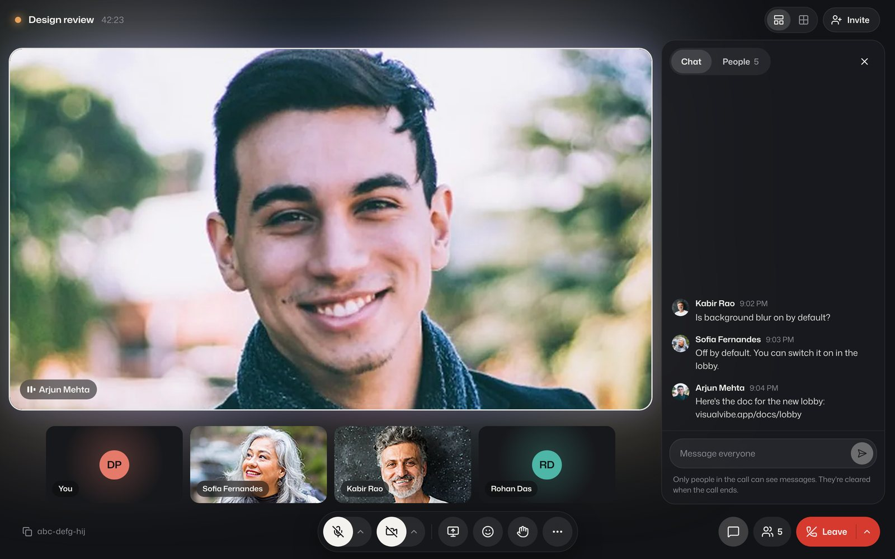
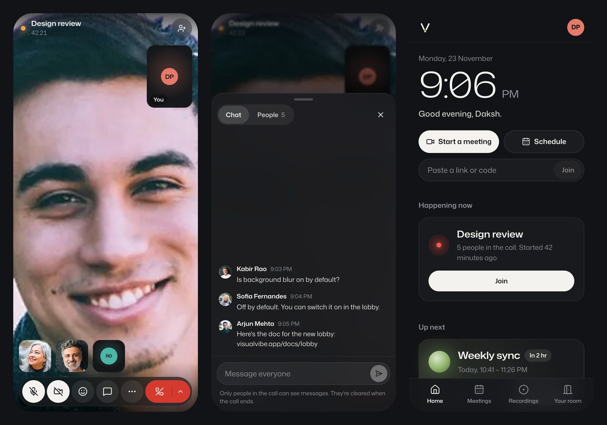

# VisualVibe

Video meetings in your browser. Start a call in one click, send the link, and talk face to face. Chat, screen sharing and recordings are built in, and it works just as well on a phone as on a laptop.



## What's inside

- **A lobby before every call.** Check your camera, mic and speakers, blur your background, and see who's already in.
- **A call room lit by whoever's talking.** The speaker takes the stage and their video softly tints the room around it. Switch between speaker and grid views; screen shares get the whole stage.
- **Made for every screen.** On phones the speaker fills the screen, you sit in a corner, and chat slides up as a sheet you can swipe away. Tablets and laptops get floating or docked panels.
- **Chat, reactions and raised hands** that everyone sees live.
- **Host tools.** Mute everyone, remove someone, record, or end the meeting for all.
- **Scheduling.** Plan a meeting, copy its invite link, add it to Google Calendar or any calendar app.
- **Your own room** at a link that never changes, with settings for how people join.
- **Recordings** you can watch in the app at any speed, or download.
- **Keyboard shortcuts** in calls: M mic, V camera, H raise hand, C chat, P people, G grid, Esc close panels.



## Run it on your computer

You need [Node.js](https://nodejs.org) 20 or newer.

1. **Make two free accounts and copy their keys**
   - [Clerk](https://dashboard.clerk.com): create an application, then open **API keys**.
   - [Stream](https://dashboard.getstream.io): create an app, then copy its **API key** and **secret**.
2. **Download and install**
   ```bash
   git clone https://github.com/GitDaksh/visualvibe.git
   cd visualvibe
   npm install
   ```
3. **Add your keys.** Make a copy of the example file, then paste your four keys into `.env.local`.
   ```bash
   cp .env.example .env.local
   ```
4. **Start it**
   ```bash
   npm run dev
   ```
   Open http://localhost:3000, sign up and start a meeting. To test with a second person, open the invite link in another browser. (Phones only allow the camera on `https` sites, so use your deployed link for phone tests.)

## Put it online with Vercel

1. Go to [vercel.com/new](https://vercel.com/new) and import this repository. Keep the default settings.
2. Under **Environment Variables**, add the same four keys from your `.env.local`.
3. Click **Deploy**. Your site is live at `your-project.vercel.app`.

Clerk's development keys work on your `vercel.app` address. Its production keys need a domain of your own, so keep the development keys unless you buy one.

## Keeping it free

The app is set up so a forgotten tab or a widely shared link can't quietly run up a bill:

- **Every meeting has a time limit.** Calls end after 2 hours by default (change it with `CALL_MAX_DURATION_MINUTES`). People get a warning 5 minutes before.
- **Personal rooms close their session** at the limit you pick on the **Your room** page, which can't be longer than the limit above.
- **Each call has a size limit** of 10 people by default (`CALL_MAX_PARTICIPANTS`).
- **Recording only starts when a host presses Record.**
- **Background blur runs on the device** and only downloads its model when someone turns it on.
- **No paid image processing.** Images ship as small, pre-sized files.

For scale, Stream gives every account $100 of free video usage each month, which is around 66,000 participant minutes of HD video ([pricing](https://getstream.io/video/pricing/)). Vercel's Hobby plan and Clerk's free plan easily cover a personal project. If you never add a payment method to these services, there's nothing for them to charge.

## Project layout

```
app/                  pages: landing, sign in, home, meetings, recordings, your room, /meeting/[id]
actions/              server actions: create and schedule meetings, room settings, call tokens
components/meeting/   lobby, call room, stage, controls, chat and people panels
components/…          dashboard, landing and shared UI pieces
lib/                  Stream server helpers, meeting codes, time formatting
```

## Scripts

| Command | What it does |
| --- | --- |
| `npm run dev` | Starts the app on http://localhost:3000 |
| `npm run build` | Builds for production |
| `npm run start` | Runs the production build |
| `npm run lint` | Checks the code with ESLint |
| `npm run typecheck` | Checks types with TypeScript |

## Built with

[Next.js 15](https://nextjs.org), [React 19](https://react.dev), [Clerk](https://clerk.com), [Stream Video](https://getstream.io/video/), [Tailwind CSS 4](https://tailwindcss.com), [Radix UI](https://www.radix-ui.com) and the [Mona Sans](https://github.com/github/mona-sans) typeface.
